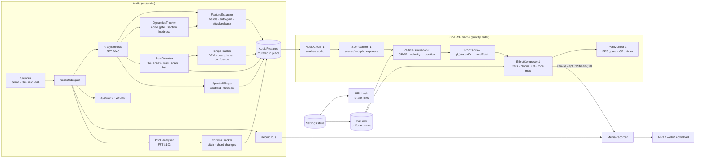

# Resonance

**A browser-based audio-reactive visual synthesizer: up to 590,000 GPU particles that pulse, twist and sparkle to your music, in real time.**


<!-- Placeholder: record a clip with the app's own record button, convert it to a GIF and save it as docs/demo.gif. -->

**[Live demo →](https://living-notes.vercel.app)**

No sign-up, no install. Click once and the scene is already moving.

---

## Features

**Audio**

- **Sources:** four bundled demo tracks (procedural placeholders until real files are added), drag-and-drop or file picker (MP3/WAV/OGG/M4A/FLAC), microphone, and **tab or system audio** (Chrome/Edge desktop) for visualizing Spotify, YouTube or SoundCloud directly.
- **Your whole album:** drop several files and they play as a queue in track order, with next and previous.
- **Any input device:** pick an audio interface or a loopback like BlackHole or Stereo Mix in the Studio.
- **Six bands** (sub-bass, bass, low-mid, mid, high-mid, treble), each with its own auto-gain and fast-attack/slow-release smoothing.
- **Song shape:** section loudness survives the auto-gain, so breakdowns are small and drops are big. A noise gate learns your room, so a silent mic is a still scene.
- **It knows the song:** load a file and it's analysed in the background into a score: every hit, the tempo, the bar, the melody, the drops and how big each moment is against the whole track. Motion then starts before a hit so that it peaks on it, and the picture waits for Bluetooth headphones. Press `B` to compare with the original reactive version.
- **The melody as a line:** the lead voice is written across the room as it's sung, with pitch as height and time running right to left. Each song uses the line's full height, and in a known song the coming notes are sketched in ahead of it.
- **Hits travel:** light starts at the core and moves outward, so a sound visibly begins somewhere.
- **Restraint:** quiet sections hold their light and motion back, right up to the downbeat, so the big ones have somewhere to go.
- **Every instrument shows:** a song is sorted by how long its sounds last, into hits, notes and what holds, with no stems or model to download. Pads and held chords become an aurora across the room, coloured by the chord, and each new chord sweeps across it. Riffs and plucked lines strike strings at their own pitch: clean notes ring smooth, distortion breaks them into teeth, and each note also lights the particles at that height.
- **A real music player:** open a music folder once and it's remembered, new songs in it appear by themselves, with search, shuffle, repeat, play next, a queue, media keys and lock-screen controls. Titles, artists, albums and cover art come from the files themselves. Nothing is uploaded.
- **Songs flow into each other:** the next song is learned while this one plays, and silence at either end is trimmed. As one song hands over to the next the form draws in and opens again, and the colours drift to the new cover.
- **The song's name on screen:** a title card opens each song, Up next appears before it ends, and a song's first big moment spells its title in particles for the drop to smash. Clips carry the title too.
- **Musical memory:** the app works out which sections are the same part of the song coming back, and each part gets a look of its own: colour, how the particles swirl, the way the form turns and the width of the lens. A chorus returns looking as it did the first time, and in Morph with its own shape. In Auto-VJ a part also keeps its scene and palette.
- **Song map:** the whole song on one strip, showing how big each section is, where it climbs and drops, and where pads, notes and hits sit. Click to jump anywhere, or press `[` and `]` to move by section.
- **Cast list:** Drums, Bass, Pads, Riffs and Voice light up as they play. Tap one to leave only that part driving the picture, which shows what each one does on screen.
- **Drops that hit:** the song is split into real sections, and its biggest arrivals become drops. Colour and light drain through the climb, the picture shakes under the pressure, time stops for a fifth of a second, then a coloured flash, a ring through the air, a lens punch and a burst all land on the kick. The section that follows stays hotter and wider until it ends. Press `B` to compare.
- **Instant hits:** hits move particles at draw time as well as in the simulation, so a kick lands on the frame it's heard instead of a fifth of a second later.
- **Groove:** once the tempo locks, every scene and the camera move on the beat itself, not just after each hit. Free-time music locks to nothing, so it's never given a groove it doesn't have.
- **Harmony:** the centre of everything sounding turns the palette around the circle of fifths, major chords warm the shadows and minor ones cool them, and every note of a chord pushes out its own lobe on Sphere Pulse. A voice or lead lifts Nebula and swells Terrain.
- **The breath before a drop:** when an expected kick goes missing, everything draws in, focus tightens and the room dims, so the drop lands harder.
- **A layer for each instrument:** kicks push outward, backbeats twist the structure one way and then the other, and hats shake a corona of fine stardust. In Nebula a heavy core throbs with the sub-bass, and a melody rises through it as three ribbons, drums or no drums. Terrain's peaks shed embers, and a landed word ripples with the voice.
- **Phrasing:** Morph and Auto-VJ wait for the 1 once the bar is known, a half-time groove nods at half the tempo, and the camera sits in close for verses and pulls back for choruses.
- **Mood:** intensity and brightness over a few seconds set a label for the vibe and a drifting backdrop, with bass rising from the floor, a voice crossing the sky and loud sections reaching the screen's edges. Auto-VJ picks looks to match: heavy drops get kinetic scenes and hot palettes, smooth grooves get fluid scenes and Velvet or Gold Dust, and beatless music stays off rigid grids.
- **What it's hearing:** the Visuals menu shows the BPM, strongest note and vibe live, and a dash whenever it doesn't know.
- **Lounge mode:** one key hides everything and turns the backdrop up until the screen works as a mood light.
- **The word on the drop:** in Auto-VJ, a known song spells your word or the track's name in particles during the climb, and the drop smashes it. Live audio can't see a drop coming, so there the word follows it and shatters on the next snare.
- **Onsets by register:** low hits (kick), mid hits (snare, piano attacks) and high hits (hats) are told apart by where the energy went.
- **Tone:** spectral centroid (brightness), flatness (tonal or noisy), and pitch from a separate long-window FFT, with chord-change detection for music without drums.
- **Live tempo and beat phase,** with an honest confidence: free-time music reports no pulse rather than inventing one.
- One slim player bar: song and cover art, shuffle, previous, play, next, repeat, volume, and a thin seek line. Hover the line to open the song map, click the clock for time left, and scroll over the volume to change it. It all fades out after 3 s so the picture has the screen.

**Visuals**

- **Five scenes:**
  - **Nebula:** a lumpy, breathing cloud of curl-noise filaments. Bass churns it, and bright sounds tighten its swirls.
  - **Sphere Pulse:** each frequency band drives its own latitude.
  - **Terrain:** a particle landscape made from a scrolling spectrogram.
  - **Morph:** every 16 beats (or on a chord change, in music without a pulse) the cloud reforms as sphere → torus knot → "RESONANCE" → double helix → torus → Lorenz attractor. Turn Auto off to pin any shape from the Visuals menu, or **type your own word** in the Studio and it travels with your share link.
  - **Cymatics:** the real physics of resonance. Particles behave like sand on a vibrating plate and settle on its Chladni nodal lines, and the note being played picks the figure.
- **Transitions never hard-cut.** Particles fly from one formation to the next.
- **The music plays the scene:** kicks push outward, snares send a shockwave ring, hats re-roll the sparkle, brightness shifts colour, section loudness sets scale, and rotation locks to the tempo.
- **A lens, not dots:** depth of field with soft bokeh discs, and fast particles stretch into streaks along their motion.
- **Post-processing:** feedback trails, bloom, snare-driven chromatic aberration, a palette-tinted atmosphere that swells with sub-bass, vignette and AgX tone mapping.
- **Auto** (on by default, press `V`): scenes and palettes follow the music, changing at drops and with each part of a song. Picking a scene takes over.
- **Appearances** (press `T`): Aura tints the interface with the song's colours, Midnight is quiet and neutral, Ember warms the room and the picture, and Paper turns the whole show into ink on paper. Your system's light setting picks Paper on a first visit.
- **Interactive:**
  - Drag to orbit and scroll to zoom, with an auto-orbit that follows the mids.
  - Moving the cursor carves a wake through the cloud.
  - Holding still creates a gravity well, shown by a charging ring; releasing it bursts the particles back out.
  - Shift-drag or the right mouse button grabs the well instantly, so you can drag it through the cloud.

**Studio** (press `C`)

- Five curated palettes plus a custom four-stop gradient, and five one-click **Looks** (the active one stays highlighted until you change it).
- Sliders for bloom, aberration, trails, depth of field, curl frequency, turbulence, spring tension and point size.
- Per-band audio sensitivity, each with a live level meter.
- **Every setting lives in the URL hash.** Copy the link and anyone sees exactly your look.

**Capture and performance**

- **Record a clip:** canvas plus audio at a steady 30 FPS to a downloadable MP4 (WebM on browsers that can't write MP4), with a countdown. Choose 15, 30, 45 or 60 seconds and a window, 16:9, 9:16 or 1:1 frame; cropped clips show a frame guide and pull the camera back while recording. Audio shared from another tab is never recorded, and switching to it ends a clip.
- **Snapshot PNG** at the same framing.
- **Particle count is picked by a GPU benchmark** (65k / 262k / 590k) and remembered per GPU. It uses timer queries only, so measuring never stalls a frame.
- **Adaptive quality:** a short benchmark picks the render resolution and particle count together. If FPS still sags over a 3 s window, resolution drops first (under 54 FPS), and particles go only if it stays under 45 at 1×.
- **Stats overlay** (press `F`): FPS, frame time and GPU time (timer query, where the browser supports it).
- Fullscreen, `H` to hide the interface for streaming or projection, and auto-hide after 3 s idle.

**Accessibility and resilience**

- Respects `prefers-reduced-motion` and `prefers-color-scheme`. Works down to 375 px wide.
- Friendly states for loading, errors, mic permission denied, missing WebGL2 and GPU context loss (it recovers automatically).

### Keyboard

| Key     | Action                       | Key                         | Action                |
| ------- | ---------------------------- | --------------------------- | --------------------- |
| `1`–`5` | Switch scene                 | `Space`                     | Play / pause          |
| `C`     | Studio panel                 | `M`                         | Mute                  |
| `F`     | Stats overlay                | `H`                         | Hide / show interface |
| `V`     | Auto                         | `N` / `P`                   | Next / previous track |
| `Esc`   | Close panel / show interface | Hold still, or `Shift`-drag | Gravity well          |
| `L`     | Lounge mode                  | `B`                         | Compare with original |
| `[` `]` | Previous or next section     | `Q`                         | Music library         |
| `S`     | Shuffle                      | `R`                         | Repeat                |
| `T`     | Next appearance              | `←` `→`                     | Back or forward 5 s   |
|         |                              | `↑` `↓`                     | Volume                |

---

## Architecture



**Key design points**

- **One clock.** The R3F render loop drives audio analysis at priority −1. Features are therefore always computed in the same frame the particles read them, and the whole app wakes once per vsync. The audio engine only runs its own `requestAnimationFrame` when WebGL is unavailable.
- **No per-frame allocation.** `AudioFeatures`, the pointer field, the scene director and the live look are all mutated in place, and React never re-renders per frame. UI meters write to the DOM through refs.
- **Attribute-free particles.** The points geometry has _no_ vertex buffers. Each vertex finds its particle with `gl_VertexID` and reads its state with `texelFetch`.
- **Scenes as steering.** Each scene returns a _desired velocity_, and the integrator steers toward it with a speed cap. A transition just blends two scenes' desired velocities on the GPU, so formations dissolve into each other instead of cutting.
- **Validated share links.** Only non-default values are written, so links stay short. The hash is treated as untrusted input: enums are whitelisted, numbers clamped and snapped, colours strictly hex.

<details>
<summary>Project layout</summary>

```
src/
  audio/        engine, sources, bands, feature extraction, beat detection, synth demo loops
  scene/        R3F stage, camera rig, scene director, spectrogram, pointer input
    particles/  GPGPU simulation, shape point-clouds, tiers + benchmark
    shaders/    noise (analytic curl), scenes, shapes, pointer, simulation, particles
    post/       custom feedback-trail effect, effect stack
  settings/     schema, palettes, looks, store, URL codec + sync
  perf/         frame-rate guard, GPU timer, monitor
  recording/    MediaRecorder clip capture
  ui/           player bar, song map, visuals menu, library, studio panel, overlays, notices
```

</details>

---

## The hard problem I solved

### Making _any_ song drive the visuals well

The obvious approach (average the FFT bins in each band and use that number) falls apart on real music. On the first working build, I measured a four-on-the-floor house loop. **Bass sat between 0.8 and 1.0 almost all the time**, so the particles barely breathed. A quiet acoustic track would have the opposite problem: nothing would ever cross the threshold. Spectral levels depend on mastering loudness, genre and microphone gain, so no fixed scaling suits them all.

The fix has three stages, each per band:

1. **Auto-gain from the band's own recent range.** Each band tracks a peak that decays over about 6 s and a floor that rises over about 2.5 s but drops instantly. The value is `(raw − floor) / max(peak − floor, ε)`, so every band uses its full 0–1 range on a brick-walled master and on a whisper alike. The ε stops silence from being amplified into noise.
2. **A contrast curve** (`x^1.6`), so sustained mid-level energy reads as calm and only real hits reach the top.
3. **Frame-rate-independent attack/release** (`1 − e^(−dt/τ)`): a 12 ms attack for punch, and 70–180 ms releases tuned per band so a 124 BPM kick has time to fall back between hits.

After these changes the same loop's bass spans **0.01–0.99**, and the scene visibly pumps on every kick.

That fixed dance music and quietly broke everything else. Auto-gain rescales any section to full height within seconds, so it also erases the shape of a song, and it will happily amplify nothing. Measured on that build: a faint room fan read as level 0.33 and fired **25 false beats in 6 seconds**, and a section 30 dB quieter peaked at 0.92 against 0.94 for the loud one, so a drop had no impact at all.

The answer was a second layer that remembers what auto-gain forgets. A noise gate learns the room's level on live inputs, and auto-gain freezes while it's shut, so it can't learn the shape of a fan. A section-loudness tracker compares the last moment against the loudest of the last minute, then scales everything by that.

The same goes for what counts as a musical event. Onset detection is half-wave-rectified spectral flux against a `mean + 1.6σ` threshold, but flux is measured in dB, where any broadband hit lifts every band. Splitting it by band alone made kicks and snares fire on each other every time. The fix was to decide a hit's register from where its _linear_ energy went. Music without drums follows other cues: a separate 8192-point FFT tracks pitch, because a 2048-point bin is wider than a semitone below 400 Hz, and chord changes stand in for beats.

To keep this honest there's an offline bench, `src/dev/audioBench.ts`. It runs the real analysers inside an `OfflineAudioContext`, so results don't depend on the tab or frame rate, against synthetic signals with known answers. They're stand-ins for each genre, not real recordings.

| Test                                   | Before                     | After                                    |
| -------------------------------------- | -------------------------- | ---------------------------------------- |
| Quiet room fan on a mic                | level 0.33, 25 false beats | level 0, 0 beats                         |
| 3 claps in that room                   | not measured               | 3 of 3                                   |
| Peak band, quiet intro → drop (+30 dB) | 0.92 → 0.94                | 0.55 → 0.98                              |
| Kick/snare groove, 100 BPM             | one channel                | 10/10 each, 0 cross-fires                |
| Kick and clap layered on 2 and 4       | snare 0/11                 | snare 11/11, 0 on plain kicks            |
| Snare over a sustained 808             | 10/11                      | 11/11                                    |
| Syncopated R&B at 76 BPM               | locked to 101.4            | 76.0                                     |
| Trap at 140 BPM, off-grid kicks        | locked to 111.9            | 139.9                                    |
| 32nd-note hat roll, 72 hits            | 25                         | 36                                       |
| Tempo of 124, 88 and 140 BPM grooves   | none                       | 124.0, 88.0, 139.9                       |
| Free-time piano, 12 notes              | none                       | 12/12 pitches, confidence 0.24 (no lock) |
| Cello vs cymbal, brightness            | none                       | 0.12 vs 0.87                             |

The layered backbeat was the worst of these, and the obvious fix failed. Pulse Engine's own claps never fired, because a kick and a clap landing together read as a kick. Comparing mid energy against low energy can't separate them: the kick carries about 70× the energy, so that ratio is 0.006 alone and only 0.014 with a clap, and any fixed threshold would break on a real mix. Snare-band flux separates them cleanly at 0.15 against 0.30, but how much a kick leaks into that band depends entirely on the track. So each track teaches the detector its own leak, and a low hit only counts as a snare too if it clearly beats it.

Tempo had the same shape of problem. Off-grid kicks with gaps of five 16ths read as a confident 112 BPM in a 140 BPM groove, so the tracker now listens mostly to the backbeat and hats, which hold the grid in hip-hop and R&B. Beat phase corrections crossing the beat could also fire two beats 83 ms apart, which a beat count can't show because the double counts and skips cancel out. Only checking the spacing between beats caught it.

Knowing where the song is came next, and two of its learners failed in the same way. `beatIndex` starts wherever tracking began, so `beatIndex % 16` means nothing until the bar is found, which comes from where snares and kicks land. The breath before a drop can't be a level check either, as bass falls between every kick, so it listens for a kick that fails to arrive against the song's own longest recent gap. Both first versions ignored the evidence that proved them wrong: hits labelled as layered weren't allowed to teach the kick leak, and gaps that ended a breath weren't allowed to teach the longest gap. Each now learns from every real kick.

| Test                            | Result                                                  |
| ------------------------------- | ------------------------------------------------------- |
| Kick stops for two beats, drops | 0 before, held at 0.98, impact 1.0                      |
| False breath, four-on-the-floor | 0                                                       |
| False breath, sparse trap, 14 s | one 0.27 s blip                                         |
| False breath, syncopated R&B    | peak 0.26                                               |
| Bar from a clear backbeat       | snare on 2 and 4                                        |
| Night Drift demo                | finds the true 1                                        |
| Pulse Engine demo (a busy mix)  | low confidence, so nothing waits for the 1              |
| Word on a real file's drop      | breath 16.6 s, word on the drop at 17.4 s               |
| Vibes of the four demos         | High energy, Melodic drift, Heavy groove, Melodic drift |

The word on the drop needed its own tests against real files, and they found an older bug. Auto-VJ compared short-term loudness against a 6 s memory, so every kick looked like a 5 dB section rise and a false drop fired about 8 s into a steady groove. That had been making Auto-VJ change too eagerly all along; it only became visible once a false drop spelled a word. Sections are now compared with sections. Rasterizing a word takes about 40 ms, so it's prepared in its own texture when the track changes, and the drop itself is only a uniform swap.

Chords were measured the same way. Reading major or minor from the third above the loudest note got 7 of 10 test chords right, as the loudest note often isn't the root. Matching whole triads got 8 of 10, and the other two can't be solved from the notes alone: Em7 and G6 are the same four notes, as are Fm7 and A♭6. So chords drive gentle colour shifts rather than anything that needs to be exactly right.

Reacting to sound has a floor: a hit can't be seen until it's been heard, measured and moved to. Knowing the song removes that floor, so the app now analyses files up front. The measurement that mattered was how long after a kick the visible motion peaks, read back from the GPU at a real 60 FPS on a composed song, Afterglow, with true stems:

| Sphere Pulse, on a drop  | Original    | Living      |
| ------------------------ | ----------- | ----------- |
| Top of the sphere        | 263 ms late | about 60 ms |
| Middle                   | 288 ms late | about 60 ms |
| Bottom                   | 388 ms late | about 60 ms |
| Ordinary track, no stems | 133 ms late | 85 ms early |

The first attempt was worse than the original, at 413 ms: the travelling wave delayed the surface the eye follows. Motion and light had to be split, because motion needs about a fifth of a second of anticipation and light needs almost none. Early bands mixed with late ones then cancelled out, flattening the swing to a third, so every band had to come from the score.

Stems make the difference to hits. From true stems Afterglow reads exactly as written, with all 94 kicks. From the bare mix the tempo is still right, but it finds 67 of those kicks and no reliable bar. Afterglow's stems come from its own synthesis, so nothing here shows yet how well separated stems from a real recording would do.

Drops needed a different approach. They were first found by comparing loudness either side of each beat, and section size was averaged across a bar, which measured badly on test mixes:

| Test                                | Loudness averaging       | Sections                 |
| ----------------------------------- | ------------------------ | ------------------------ |
| Steady groove, no drop              | 4 false drops            | none                     |
| Real drop at 40 s                   | missed; marked the start | 40.0 s                   |
| Section size 0.05 s before the drop | already 0.86 of 1        | 0.39, then 1 on the kick |
| Afterglow from the bare mix         | no drops                 | 38.4 and 76.8 s          |

The averaging was the bigger problem: it spent the contrast before the drop arrived. Sections now come from the split that best explains the song as stretches of steady sound, measured against how much each instrument normally wanders, so a loud master can still change and a chord change can't fake it. The drop's flash had also been firing 190 ms early, because it shared the read-ahead meant for motion. Mean screen brightness across Afterglow's first drop now goes from 5 to 144 out of 255, where the original went from 31 to 44, and all of it held 60 FPS with no late frames.

Pads and riffs needed something else again: they barely reached the picture at all. Adding a pad moved the mid bands by 5–7% of their range, because nearly everything on screen reacts to change, and a held sound doesn't change. So sounds are now sorted by how long they last. Hits stand out across the spectrum for an instant, notes stand out along one pitch for a moment, and whatever fills most of a second is held. A riff's root note can fill half of any second, so held means present for 70% of it, not merely the median. Read from a finished, limited mix of a test song:

| Section               | Held | Notes |
| --------------------- | ---- | ----- |
| Drums and bass        | 0.02 | 0.01  |
| Plus a pad            | 0.65 | 0.24  |
| Plus a distorted riff | 0.35 | 0.90  |
| Plus both             | 0.52 | 0.92  |

Of that riff's 16ths, 53% were found, mostly missing repeats of the same pitch, and 98% of those found had the right note. A guitar also lives exactly where a filtered snare lane listens, so a riff used to hide 78% of the snares; only hits may count as snares now, which finds them all, though 38% of what it reports is still a kick or hat. The analysis takes about 2.5 s for a four-minute song and now runs in a worker: it used to freeze the page for about 400 ms just after a song started, and the worst frame is now 36 ms.

Real records then broke several of those assumptions, tested on eleven hip-hop tracks. Chrome refused every one of them outright: it can't open a FLAC with cover art embedded, though it reports that it can play FLAC, so the art is now taken out as a file loads. Past that, a busy pattern could read 133 BPM as 89, so tempo now has to divide the gap between snares evenly. A tempo a fraction out drifted by up to 70 ms by the end of a song, so the grid is now set by how tightly every hit in the song agrees with it, which holds a steady song within about 30 ms and usually under 15, and gives a far more honest confidence: a rubato piano ballad now reads as having no reliable beat, and gets no drops. And rapping counted as riff notes, 1,500 of them in one song. Lead vocals are mixed dead centre, so stereo now tells a voice from an instrument.

| Song               | Tempo before | Tempo now | Grid error, end of song | Drops found before | Now |
| ------------------ | ------------ | --------- | ----------------------- | ------------------ | --- |
| Don't Kill My Vibe | 89           | 134       | 89 ms → 9 ms            | 4                  | 4   |
| Many Men           | 103          | 155       | 70 ms → 28 ms           | 0                  | 3   |
| EARFQUAKE          | 80           | 80        | 24 ms → 15 ms           | 0                  | 4   |
| GOD.               | 133          | 133       | 47 ms → 8 ms            | 3                  | 4   |

Seven more songs from other genres, house, EDM, metal, classic rock, post-rock and ambient, found what hip-hop couldn't. House read at half speed, because accents every other beat hid a steady kick, so a kick pulse now counts as the beat. Drops landed on the pickup before them, or on a harder kick after, so a drop is now the first hit that holds. A live drummer lost the steady grid entirely, with hits no closer to it than chance, so loose songs now have their beats followed one by one, which brought The Trooper's hits to within 10 ms of a beat. And a slow ambient piece counted 655 notes, because a soft swell looks like a note unless it has to jump at its own pitch. Distortion turned out to separate well with no extra work: 0.80 on The Trooper, 0.29 on Hotel California and 0.02 on Brian Eno.

The melody line needed the same treatment. Reading pitch moment by moment hopped between harmonics, which drew a dense zigzag on real songs and matched Afterglow's true melody exactly only 2% of the time. It's now one path through the whole song, in which every leap has to earn its place, read from the centre of the mix. That covers 85% of the melody, up from 59%, is exact 44% of the time, and leaps about a third as often as it first did on real songs.

The biggest performance fix wasn't in the graphics at all. On integrated graphics, a third of frames arrived late even though the GPU had time to spare, and switching things off one at a time pointed at the controls. Faded out at zero opacity, they were still being composited over the stage on every frame, along with a small spectrum meter redrawn on a GPU canvas. Hiding them properly and moving the meter to the CPU took it to 0 late frames in over a thousand. Removing backdrop blur and making colour fringing optional cut work further, as fringing alone needed a whole extra pass over the screen.

A clean bench still isn't a real room. On an actual laptop mic in a quiet room, the same gate sat wide open, because the synthetic fan differed from real input in three ways:

- **Streams open on digital zeros.** Calibration learned the room as −120 dBFS, then climbed at 2 dB/s, so the gate stayed open for over half a minute. Silent frames no longer count, and calibration now averages power over 2 s, which outlasts a driver fading the stream in.
- **Real rooms flutter.** Frame to frame the level swung about 10 dB around −44 dBFS. Comparing a held peak against a floor that hugs the quiet moments left the gate chattering, so sustained sound and single instants are now judged separately, with a 14 dB margin for instants.
- **The bench caught the first fix.** Judging sustained sound on loudness let one clap prop the gate open for seconds, turning 3 claps into 12 beats. Averaging in dB rather than power fixed it: a clap barely moves a dB average, while real sound still arrives in about half a second.

Measured on that mic, with speaker output metered to confirm what really played: a room at −47 dBFS now reads gate 0, level 0 and 0 beats, and 3 test clicks played through the speakers gave exactly 3 beats.

### Runners-up

- **Bounded flow fields.** Integrating curl noise as a _force_ let particles reach about 30 units/s² and slowly escape the frame. Steering toward a _target velocity_ keeps speed bounded however loud the track gets.
- **Measuring the GPU honestly.** A first benchmark timed the simulation with a 1-pixel readback, because `gl.finish()` returns immediately on ANGLE. It reported 16 ms for a step that takes 0.6 ms, so a fast machine could drop to the lowest tier. The readback measures queue and compositor waits, not your work. Timer queries fixed that, and showed about 9.5 ms of every frame is post-processing that doesn't scale with particle count. Tiers are now predicted from whole-frame and simulation time, with separate budgets for moving up and down, and any stalled frame discards the run, because a throttled page's idle GPU reads as a weak one.
- **Feedback trails that can't blow out or smear.** The custom trail effect keeps `max(current, previous × decay)` rather than accumulating. With accumulation, a resting particle would converge to `current / (1 − decay)`, 16× too bright at 0.94. Because trails live in screen space, they also fade out while the camera moves fast, and return once it settles.

**Measured on an Intel Iris Xe** (integrated laptop GPU) at a 1920×1140 canvas, using GPU timer queries:

| Particles | Whole frame | Simulation | Frame rate |
| --------- | ----------- | ---------- | ---------- |
| 65,536    | ~10 ms      | 0.7–0.9 ms | 60 FPS     |
| 262,144   | ~11.4 ms    | 1.2–1.4 ms | 60 FPS     |
| 589,824   | 14–16 ms    | 1.8–2.1 ms | 54–59 FPS  |

With every layer in place, real-time playback at a 1444×847 canvas holds 60 FPS in all five scenes at 262k, with at most 1 late frame in 180, at 10.8–11.3 ms of GPU time a frame.

On a 2× screen, resolution matters far more than particle count. Same GPU, 262k, real-time playback in Chrome:

| Render resolution | Frame rate | Late frames (of 240) |
| ----------------- | ---------- | -------------------- |
| 1.5×              | 33 FPS     | 123                  |
| 1.25×             | 48 FPS     | 57                   |
| 1×                | 60 FPS     | 0                    |

Dropping from 262k to 65k at 1.5× gained only 3 FPS, so Auto gives up resolution before particles.

---

## Local setup

Requires Node 20+.

```bash
npm install
npm run dev        # http://localhost:5173
npm test           # unit tests (Vitest)
npm run lint       # ESLint
npm run typecheck  # TypeScript, strict
npm run build      # static site in dist/
```

**Demo tracks:** drop royalty-free files at `public/audio/demo-1.mp3` to `demo-4.mp3`. Titles live in `src/audio/demoTracks.ts`. Until then, each preset plays a loop synthesized in the browser with an `OfflineAudioContext`.

**Audio bench:** with the dev server running, paste this into the browser console. It takes about 20 seconds.

```js
(await import('/src/dev/audioBench.ts')).runAudioBench().then(console.table);
```

**Deploying:** it's a static site with no backend or environment variables. On Vercel, import the repository and `vercel.json` sets the rest: the build, Node 24, year-long caching for hashed files, and a strict content security policy. The microphone and tab audio require HTTPS, which Vercel provides. Don't add a catch-all rewrite: the app has one page, and demo tracks rely on a missing file returning 404.

### Browser support

|                     | Chrome / Edge | Firefox                    | Safari                     |
| ------------------- | ------------- | -------------------------- | -------------------------- |
| Visuals (WebGL2)    | ✓             | ✓                          | ✓ (15+)                    |
| Mic, files, demos   | ✓             | ✓                          | ✓                          |
| Tab / system audio  | ✓ desktop     | — (button hidden)          | — (button hidden)          |
| Record clip         | MP4           | WebM                       | MP4                        |
| GPU time in stats   | ✓             | n/a                        | n/a                        |
| Auto particle count | Benchmarked   | Device default + step-down | Device default + step-down |
| Fullscreen          | ✓             | ✓                          | ✓ Mac · hidden on iPhone   |

Without WebGL2 the app shows a clear message and keeps the music playing.

**Known limitations**

- The audio analysis has been tested against synthetic signals and one real microphone, not a library of real recordings. Expect to tune it on real music.
- Internet radio URLs aren't supported: most streams send no CORS headers, so Web Audio receives silence, and a static site has no server to proxy them. Tab audio covers that case.
- Dropping a folder doesn't work; drop the files inside it.
- Only Afterglow has true stems. Other files use filtered bands, which find the tempo but miss many hits. Mic and tab audio still react live, since nothing can be known in advance, so they get the impact but no climb and no hang.
- Drop and voice detection have been tuned on eighteen songs across seven genres and on synthetic mixes, with no hand-marked answers, so a real song can still have a drop missed, a chorus promoted to one, or a part sorted wrongly.
- Instrumental leads mixed dead centre light up Voice, even with no singer.
- Sections are matched by their harmony and how much of each part is in them, not note for note, so two parts that sound alike can be taken for one.
- A melody sample mixed dead centre reads as Voice rather than Riffs, and a song whose tempo changes part way still gets one tempo.
- Voices are sorted by behaviour, not instrument: a held guitar chord shows as a pad, and a fast synth arpeggio as strings. Mic and tab audio get a rough live version of both.
- A song with a changing tempo gets one average tempo from its score.
- Finding the bar needs a clear backbeat. On busy mixes confidence stays low and changes land on any beat rather than the 1. Four-on-the-floor can't tell beat 1 from 3.
- Mood describes energy and brightness, not emotion: it can't tell joy from sorrow.
- "Note" is the strongest pitch at that moment, not the song's key.
- Chord colour is noisy on a full mix, where drums and bass share the spectrum with the harmony.
- Hat rolls faster than about 10 hits a second are only half detected: the 2048-point FFT window spans 43 ms, so neighbouring hits blur together.
- WebM clips can lack a duration header, so some players show no total length until the file has played once. VLC and browsers play them fine.
- While recording on an integrated GPU, the visible REC pill costs the live view about 10 FPS: with anything drawn over the canvas, encoding no longer fits the frame. With nothing over it, the live view held 60 FPS.
- Tab audio requires ticking "Share tab audio" in Chrome's picker; the app explains this if no audio arrives.

---

## Tech stack

- **Vite**, **React 19** and **TypeScript** (strict, `noUncheckedIndexedAccess`)
- **three.js** via **React Three Fiber**, **drei** (OrbitControls) and **@react-three/postprocessing**
- **GPUComputationRenderer** for GPGPU ping-pong simulation on WebGL2
- **Web Audio API**: `AnalyserNode`, `OfflineAudioContext`, `MediaStreamAudioDestinationNode`
- **MediaRecorder** and `canvas.captureStream`
- **Zustand** for state, **Vitest** for tests, **ESLint** and **Prettier**
